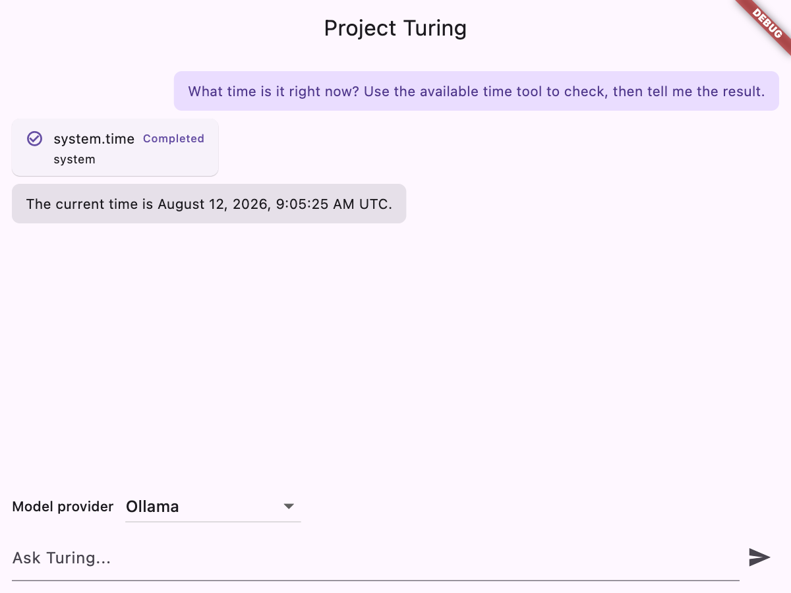

# TuringAgent

TuringAgent is a local-first AI orchestration platform for running a private assistant stack on your own machine. It pairs a Flutter client with a Go gRPC backend that owns chat sessions, model routing, streaming events, tool execution, approvals, and audit state.

The project is designed for local development first: secrets stay in your local `.env`, data is stored under `turing-backend/data/`, file tools are constrained to `turing-backend/sandbox/`, and the memory vault — the persona, profile, beliefs and proposals Turing keeps as plain Markdown you can open in Obsidian — lives under `turing-backend/memory/`, which is ignored by git except for its `.gitkeep`. The specialists Turing can hand work to (experimental, off by default) are files too, one `turing-backend/team/<id>/AGENT.md` each, also ignored by git except for its `.gitkeep`.

## What it does

- Runs a Go gRPC orchestrator for sessions, messages, runs, events, and approvals.
- Runs a Go agent runtime that connects to local or OpenAI-compatible models.
- Requires a fresh destination and data-category confirmation for every remote
  run; the decision is recorded with the run and cannot authorize background work.
- Exposes an HTTP JSON-RPC tool subset for safe system tools and
  approval-gated sandboxed file tools, with endpoint and policy management.
  See the [current protocol scope](docs/NORTH_STAR.md#guarded-capability-inventory).
- Provides a Flutter client with settings, conversation search, automatically
  named and paginated session lists, rename/archive/restore actions, chat,
  streamed responses, localized durable run-outcome cards, and approval cards.
- Shows server-derived, bounded file previews before approval, binds the
  decision to the reviewed arguments and file state, and refuses stale writes.
  See [approval review, limits, and compatibility](docs/architecture/approval-previews.md).
- Provides an explicit **Stop** action for a run, backed by durable,
  retry-safe cancellation. Acceptance and worker shutdown are separate;
  completed side effects are not undone.
- Exposes a redacted, paginated audit read API (`AuditService.ListAuditEntries`), including the approval comment or denial reason a person typed; audit inspection is exposed programmatically through the authenticated API, with no client or built-in viewer yet.
- Withdraws a deleted session through a durable lifecycle: reads/search/replay
  fail closed once withdrawal starts, active work is cancelled and reconciled,
  existing subscribers receive one terminal deletion event, and newly
  session-owned sandbox artifacts are removed by policy.
- Ships a Docker Compose local stack and an end-to-end gRPC smoke test.

Current capability status and future work are separated in the
[canonical roadmap](docs/NORTH_STAR.md#current-status). The Flutter shell has
backend-connected Chats, Skills, Memory, Integrations, MCPs, Automations,
Agents and Telemetry surfaces. Agents manages model endpoint records and
Turing's team of specialist profiles (enablement and revision-bound grants;
delegation is off by default and experimental);
[integration and routing limits](docs/NORTH_STAR.md#guarded-capability-inventory)
distinguish credential storage, functional tools, inference and delegation.

## Stopping a run

Use **Stop** beside the assistant response to cancel that exact run, including
one waiting for a worker or approval. A lost response is shown as unconfirmed;
**Retry cancellation** reuses the same operation identity. **Check status**
reads the backend's current cancellation and execution observation.

Closing a conversation or losing its event stream is not a Stop action.
Cancellation does not need a model call, remote-provider consent, or approval.
An older backend without the cancel API is shown as unsupported; the client
never substitutes dropping the stream. See [cancel results, recovery and
upgrade behavior](docs/architecture/run-outcomes.md#explicit-cancellation).

## Account integrations

GitHub is the only account integration with functional tools: list issues,
read an issue, read a repository file, and create an issue comment. In
**Integrations → Connect an account**, paste a personal access token and
acknowledge its grants. Credentials are sealed at rest with
`TURING_INTEGRATION_KEY`; tool calls retain the existing approval and per-run
egress requirements.

IMAP, CalDAV, and Notion remain visible as unsupported because their tools
are not implemented. New connection requests, including requests from older
clients, are rejected before credential sealing or storage. Google, Microsoft,
and Slack account connections and tools are also unavailable.

Accounts saved by earlier releases remain visible with their original stored
status and recorded consent. Turing does not automatically revoke, delete,
decrypt, or use the credentials for those unsupported providers. Choose
**Revoke access** to delete a connection's local credential while retaining its
record, or **Remove** to delete the saved connection row and credential.
Cleanup remains available without the sealing key or when the provider catalog
fails to load. Audit records remain. Local cleanup does not revoke a token or
app password at its vendor or destroy copies elsewhere; revoke it at the
vendor separately when needed.

## Turing's team

Turing is the orchestrator agent. The specialists it can hand work to are
profiles, one Markdown file each at `turing-backend/team/<id>/AGENT.md`: front
matter names the model, tool patterns (the tool name without its server:
`files.read`, not `files/files.read`), skills, memory access
(`none`, `read` or `propose`), the tools it `requires`, and an optional
`max_tool_calls`; the body is its instructions. The file starts with `---`
front matter in which `name` and `description` are required, `emoji` and
`version` are display-only, and an unknown key is an error. The folder name is
the profile's ID: a lowercase letter, then lowercase letters, digits or hyphens,
2–32 characters in all, and `turing` is reserved. The templates are the
reference format to copy. A fresh install gets three, from
`turing-backend/scripts/team-templates/`:

- 💻 **Dev** — `files.*`, `system.*` and `github.*`. GitHub calls leave the
  machine, so once GitHub is connected its card says it asks you before each
  task, and each task it is given waits for you to allow those tools or run
  without them.
- 📨 **Inbox** — `gmail.*` only, and it requires it. No Gmail tools exist yet:
  its card says why from the start, and once you turn it on and grant it, it
  shows Unavailable.
- 🔬 **Research** — memory search and read, `files.*`, skills and the time,
  and asks for up to 12 tool calls per task (the worker's own per-run limit
  still applies).

`init.sh` copies them only on the first install, into a `team/` that has no
profiles yet, and leaves a `data/team-seeded` receipt beside the database. It
never rewrites an edited profile or brings back one you deleted — not even
after you delete them all — because your grants for them are still in the
database. To bring one back, copy its folder from `scripts/team-templates/`
into `team/`; it returns with the on/off setting and grant it had. If that grant
matches the template, no new review is asked for, so a profile that was on can
be Active again at once; otherwise it needs a new grant first. Dev and Research
require nothing, so on and granted they are Active whenever a worker that
speaks the team protocol serves their model and nothing else claims the name
`team` (below); Inbox requires `gmail.*`, so its card lists that tool, and on and
granted it shows Unavailable until it resolves. Turning it off keeps the
grant, so turning it on again does not ask.

To forget one profile's setting and grant, stop the stack, back up
`data/turing.db`, and run
`DELETE FROM agent_profile_settings WHERE profile_id = '<id>';` in a SQLite
client. `data/` is the whole database — every conversation, approval, audit
entry and connection — so deleting it is a full reset (`scripts/reset.sh`), not
a way to forget grants. A reset leaves `team/` as it is: `init.sh` seeds again
only into an empty `team/`, and only when the receipt is gone. Deleting only the
receipt reseeds an empty `team/` with the database kept, so each default returns
with the setting and grant it had.

**Agents → Turing's team** lists every profile with its state: Active, Off,
Needs your grant, Unavailable (with the reasons) or Cannot be read (with the
parse error). Turning one on first shows what the grant covers — the model,
memory access, the tool patterns it asks for and those it requires, the tools
it would receive now and those it would not, its skills and its tool-call
limit — and the grant is
bound to that revision of what the file asks for. Change its model, tools,
skills, memory access, `requires` or `max_tool_calls` and the profile needs your
grant again; editing its name, emoji, description or instructions does not. A
grant sent for a revision that has since changed is refused and nothing is
recorded. A pattern that is only `*` is rejected, and a folder
without an `AGENT.md` is not a profile.

**Delegation is off by default, and experimental.** With
`TURING_AGENT_TEAM_ENABLED=true` (in `.env`, default `false`), each Turing turn
on a local model that a team-protocol worker can serve records the Active team,
only such a worker takes that turn, and Turing is offered `team.delegate`. A
call to it queues the specialist's task in a hidden conversation that the
specialist then works on. The tool is safe by default. The app has no control
for its policy yet; `McpRegistryService.UpdateToolPolicyByName` (server `team`)
can make it require approval or disable it.
When the turn and every task it delegated have finished, the results are added
to the conversation and Turing answers from them in a follow-up reply. Each
result is cut to `TURING_DELEGATION_RESULT_MAX_BYTES` (default 8192), and the
cut is marked. A turn that fails or that you cancel stops the tasks it started,
and a note in the conversation says whose work was stopped. In the app, each
task is a card under the turn that asked for it, with who is doing what and how
it is going, **Cancel** while it runs and **View work** to read the
specialist's conversation. A task's approval is decided on its card. The
results show as a collapsed "Results from the team" row, Turing's answer from
them is marked with who helped, and a note that work was stopped is a status
line. Reopening a conversation rebuilds the cards. A task whose specialist
would use a tool that leaves the machine, such as GitHub, waits on its card
until you decide for that task alone: **Allow…** shows where its tool calls may
go and what may leave, as a send's consent does, and **Run without** runs it
with its local tools — or, when the specialist requires those tools, **Decline**
stops it. Turing's own consent never carries over to a task.
Profiles can be turned on and granted either way.

The name `team` belongs to Turing's delegation tool, `team.delegate`. Registering
or importing an MCP server named `team` (in any letter case) is refused, and so
is a third-party tool whose name starts with `team.`. An install that registered
one earlier keeps it, but while it exists no profile can be Active: every
profile that can be read lists the reason first (one that would otherwise be
Active is Unavailable), a profile that cannot be read still shows only its
parse error, and the MCP settings show the same reason on that server: "Delegation is off: an MCP server named `team` exists. Remove it and
register it under another name." or "Delegation is off: `<server>` provides a
tool named `<tool>`." A server named `team` also stops being offered or called.
Remove it, or that tool, and the next worker registration restores the name. See the [orchestrator and team design](docs/superpowers/specs/2026-10-03-turing-orchestrator-agent-team-design.md).

## Requirements

- Docker and Docker Compose
- Go 1.26+ — all three modules (root, `turing-backend/mcp-files` and
  `turing-backend/mcp-system`) declare `go 1.26.0`, so 1.26 is the floor for
  building every module with one toolchain
- Flutter, on a release bundling Dart 3.12.0 or newer within Dart 3.x:
  the current [`cupertino_icons` 2.0.0 dependency](https://pub.dev/api/packages/cupertino_icons/versions/2.0.0)
  requires `^3.12.0`. The app-declared Dart SDK constraint remains `^3.10.4`
  in `turing-client/turing_app/pubspec.yaml`; that declaration alone is not
  sufficient to resolve the current dependencies. CI tracks the `stable`
  channel rather than pinning a Flutter version.
- A local inference engine on the host: Ollama for the default path, or any
  OpenAI-compatible server on the same machine (ds4, llama.cpp's
  `llama-server`, LM Studio, Lemonade, vLLM) with `TURING_LOCAL_ENGINE=openai`
- A non-root host account for backend initialization and Compose launches

By default, containers reach Ollama at `http://host.docker.internal:11434`.
On Linux, `host.docker.internal` is the Docker bridge's gateway, so the
engine must listen there, not only on `127.0.0.1`; avoid `0.0.0.0` on a
shared network. The app's model picker shows the local route as
`Local · <engine>`, and Settings names the engine and model serving it.

## Install and run

Clone the repository and initialize local backend secrets:

```bash
git clone https://github.com/mcasillas17/TuringAgent.git
cd TuringAgent/turing-backend
./scripts/init.sh
```

`init.sh` rejects root execution, creates `turing-backend/.env`, generates local
bearer tokens, records the current non-root UID/GID for bind-mounted storage,
creates `data/`, `skills/`, `mcp/`, `team/` (seeding Dev, Inbox and Research
on the first install only), a real (non-symlink) `sandbox/`, and the
memory vault `memory/` with its `inbox/` and `beliefs/` folders and an active
starter `persona.md`, pinned into every run exactly as written (written only
when that file is absent — an existing `persona.md` or `profile.md` is
secured to `0600` and never rewritten), and
prints the Flutter client API key. It fails rather than changing ownership or
permissions when existing sandbox content is inaccessible. Do not commit `.env`.

Start the backend stack with the `turing` command, which lives next to
`init.sh` in `turing-backend/`:

```bash
./turing start     # build the images the first time, start Turing, and wait until it is healthy
./turing status    # one-screen health report; exits 1 when a check fails
./turing connect   # the backend URL and the key the app asks for
./turing config    # change settings from a menu, without editing .env
```

`./turing start` builds and runs the orchestrator, agent runtime, and MCP servers through
Docker Compose. Compose publishes the public gRPC API on `127.0.0.1` only;
its host port defaults to `3000` and can be changed with
`ORCHESTRATOR_PUBLIC_PORT`. The orchestrator listens on all interfaces inside
its container; the host restriction comes from Compose's port publication,
not an in-process loopback check.

`./scripts/dev.sh` is kept as the foreground development loop: it runs
`init.sh`, then builds the stack and runs it in your terminal with its log
output. Use `./turing` to run Turing in the background.

The supported client setup runs on that same host. A LAN/Tailscale client URL
alone does not expose the loopback service. iOS/Android scaffolding and
responsive layouts are not production mobile support: device pairing and
non-loopback identity/TLS remain future work, and Android's main manifest
lacks network permission. See the [Flutter deployment limits](turing-client/turing_app/README.md#run-locally);
do not widen the host publication or add a public tunnel as a shortcut.

Use `./turing` or the repository scripts rather than invoking this Compose file directly.
`scripts/compose.sh` validates and injects the current non-root host UID/GID;
this prevents stale `.env` values or exported `HOST_UID`/`HOST_GID` variables
from selecting the identity used for the data, skills, memory, team, and sandbox
bind mounts, and it refuses to launch when one of those host directories is a
symlink, is missing, or is not mode 0700. All backend services otherwise run
with read-only roots, no Linux capabilities, and `no-new-privileges`; only
`/app/data`, `/skills`, `/memory`, and `/sandbox` are writable, and `/memory` is
mounted into the orchestrator alone. `/team` is mounted into the orchestrator
alone as well, read-only: profiles are edited on the host, never by Turing.

`/memory` is a path inside that container, so the Memory page does not show it.
`scripts/init.sh` writes the host directory the vault is bound from into `.env`
as `MEMORY_DISPLAY_ROOT` — as a single-quoted literal, so a checkout path
containing `$`, `#`, a space or an apostrophe reaches the stack as the path that
is actually on disk — Compose passes it to the orchestrator, and that is the
folder the app names as the one to open in Obsidian. It is display only: every
read, write and confinement check still goes through `MEMORY_ROOT`.

`scripts/compose.sh` refuses to start or resolve services when that value is
missing, empty or not a clean absolute path, and says to run `init.sh`. The
compose file itself only passes it through: a required interpolation there would
be evaluated on `down`, `stop` and `rm` too, and teardown has to work on the
broken install it is being run to fix — including the `down --remove-orphans`
that `scripts/reset.sh` runs before it deletes local data.

Then, from the repository root, run the Flutter app on the machine that runs
Turing (in another terminal if you started the stack with `./scripts/dev.sh`):

```bash
cd turing-client/turing_app
flutter pub get
flutter run -d macos
```

On first launch, enter:

- **Backend URL:** `http://localhost:3000`
- **API key:** the `Flutter client API key` printed by `./scripts/init.sh`, which
  `./turing connect` shows again at any time

The sandboxed macOS builds include the outbound-network entitlement required to
reach the local backend.

### Linux desktop client

On a Linux server, run the Linux desktop app on the server itself: until device
pairing (SEC-001) ships, Turing accepts the app only from the machine it runs
on, so a Mac or phone cannot reach a headless server. Use `-d linux` instead of
`-d macos`:

```bash
cd turing-client/turing_app
flutter pub get
flutter run -d linux
```

- **To build:** Flutter's Linux toolchain, plus the development packages
  `clang cmake ninja-build pkg-config libgtk-3-dev libsecret-1-dev`. On Debian
  or Ubuntu:
  `sudo apt-get install -y clang cmake ninja-build pkg-config libgtk-3-dev libsecret-1-dev`.
  `libsecret-1-dev` is what `flutter_secure_storage` links against, and CI
  builds the Linux app (`flutter build linux`) with exactly these packages.
- **To run:** a Secret Service keyring, for example `gnome-keyring`, running
  and unlocked in the desktop session, because `flutter_secure_storage` keeps
  the API key there. Without one, the app cannot save its key.

`flutter run -d linux` needs a graphical session on the server. The CI job
builds the app but does not launch it.

### The `turing` command

`./turing` builds a small Go program each time it runs (it needs Go 1.26+, and
Go's build cache keeps later runs quick). It refuses to run as root, because
the files it manages belong to the account that ran `init.sh`. Symlink it onto
your `PATH` to run it from anywhere. `./turing help` prints the full usage.

| Command | What it does |
|---|---|
| `./turing start [--build]` | Starts Turing and waits until it is healthy. `--build` rebuilds the images first; run it after pulling a new version. |
| `./turing stop` | Stops Turing. It stays stopped after a reboot. |
| `./turing restart [--build] [--yes]` | Stops, then starts. This ends a reply in progress, so it asks first. |
| `./turing logs [service] [-f]` | Shows a service's recent log; `-f` follows it. The service is `orchestrator`, `runtime`, `files` or `system`; the default is all four. |
| `./turing status` | One-screen health report. It never prints a secret, and exits 1 when a check fails. |
| `./turing connect [--rotate-key] [--yes]` | Shows the backend URL and the key for the app. `--rotate-key` makes a new key and, when you agree, applies it by restarting the orchestrator. `scripts/rotate-client-key.sh` now calls this. |
| `./turing config` | Changes settings from a menu, at a terminal. |
| `./turing config show`, `get KEY` | Lists the settings you can change, or prints one. A secret shows only as set or not set, and is never printed. |
| `./turing config set KEY [VALUE]`, `unset KEY` | Changes one setting, as described below. `--no-apply` saves without restarting, and `--yes` answers the questions. `KEY` may be `TURING_AGENT_API_KEYS.<name>` for one agent's key. |

`turing config` is how settings are changed without editing `.env`:

- **A secret is never taken on the command line**, where it would reach shell
  history and the process list. It is asked for with typing hidden, or read
  from standard input with `--stdin`.
- **Each change is checked first.** The orchestrator and the agent runtime
  each run their own `check-config` on the new value, the way startup would
  load it, and `.env` is written only after both accept it. A refusal names the
  setting and nothing is saved.
- **Applying a change recreates the containers it affects** and waits for them
  to be healthy. If they do not come up, it offers to restore the previous
  settings and apply them again.

The command never opens the database. It talks to the orchestrator only as a
client, for its health check.

`setup` and `engine` are listed in `./turing help` but are not available yet.
Nor does this version reach the server from another machine: until SEC-001, the
app runs on the machine that runs Turing, and `./turing connect` run over SSH
says so.

## Verify the stack

Run the backend smoke test:

```bash
cd turing-backend
./scripts/smoke-grpc.sh
```

To verify that a real Ollama model chooses `system.time` from a natural-language
prompt and uses its result, run the on-demand live check:

```bash
cd turing-backend
TURING_VERIFY_MODEL=qwen2.5:7b TURING_VERIFY_ATTEMPTS=3 ./scripts/verify-tool-loop.sh
```

The live check prints `PASS`, `FAIL`, or `INCONCLUSIVE`. Exit code `0` means
`system.time` completed and the later final answer reflected the returned UTC
timestamp in post-tool output using ISO, clock, or Unix epoch form. Exit code
`1` means that exercised
lifecycle was broken; this includes a timeout after `system.time` starts. Exit
code `2` means the proof could not exercise that lifecycle, including
unavailable Ollama or model, setup failure, a pre-tool timeout, a different tool
choice, no tool choice, or an answer that could not be correlated to the
returned time.
Set `TURING_VERIFY_OLLAMA_URL` when Ollama is exposed at a non-default host URL.
The wrapper maps localhost to `host.docker.internal` for Compose; set
`TURING_VERIFY_OLLAMA_CONTAINER_URL` only when containers need a different URL.
Recoverable model-generated tool arguments are retried within the same run and
remain inconclusive unless a later `system.time` call succeeds. Explicit model
provider failures and output/tool-call guardrails are also inconclusive rather
than loop failures. This non-deterministic check is intentionally not run in CI.



`CLAUDE.md` documents the contributor verification matrix. The commands below
also include Go vet and the explicit `.github/workflows` suite used locally
and in CI (see `.github/workflows/ci.yml`).

Run developer checks from the repository root:

```bash
(cd turing-backend/mcp-files && go mod download)
(cd turing-backend/mcp-system && go mod download)
go test -tags sqlite_fts5 -race ./... -count=1
go test -tags sqlite_fts5 ./.github/workflows -count=1
go vet -tags sqlite_fts5 ./...
go build -tags sqlite_fts5 ./...
(cd turing-backend/mcp-files && go test -race ./... -count=1 && go vet ./... && go build ./cmd/server)
(cd turing-backend/mcp-files && go test -tags sqlite_fts5 -race ./cmd/server -run TestReal -count=1)
(cd turing-backend/mcp-system && go test -race ./... -count=1 && go vet ./... && go build ./...)
(cd turing-client/turing_app && flutter analyze && flutter test)
```

TUR-019 already enforces protobuf compatibility in CI with
`tools/proto/breaking.sh`; `tools/proto/check.sh` separately checks deterministic
Go and Dart generation. See the [pinned toolchain guide](tools/proto/README.md).
The [documentation guard](tools/docs/README.md) covers explicit status claims
and tool versions; it does not replace the behavioral suites.

For deterministic recall evaluation without running the stack or a model:

```bash
go test -tags sqlite_fts5 ./turing-backend/recall/eval -count=1
```

The [recall evaluation guide](turing-backend/recall/eval/README.md) documents
the synthetic corpus, stage-specific metrics, baseline updates and separate
latency benchmarks. The existing root CI race suite includes its regression
gates. Search hits, runtime-selected excerpts and evidence in the final budgeted
request are measured separately; this does not evaluate generated answers.

## Configuration

Backend configuration lives in `turing-backend/.env`, copied from `turing-backend/.env.example`.
`./turing config` changes a setting without editing that file by hand, and
checks it with the services before saving it (see [the `turing` command](#the-turing-command)).

To check a change you made by hand before starting the stack, run each service's own check
from `turing-backend/`:

```bash
./scripts/compose.sh run --rm --no-deps turing-orchestrator check-config
./scripts/compose.sh run --rm --no-deps turing-agent-runtime-general check-config
```

Each check loads the configuration the way startup does, then stops: it opens
no database or file and contacts nothing. It exits non-zero and names the
setting it refuses. Deprecated names are reported as warnings. It needs images
built from this version or later, because an older image ignores the argument
and starts the service, so rebuild first (`./scripts/compose.sh build`). An
image that can check carries the `org.turing.checks` label.

Common values:

| Variable | Purpose |
|---|---|
| `TURING_CLIENT_API_KEY` | Bearer token for Flutter and other public gRPC clients |
| `TURING_RUNTIME_TOKEN` | Bearer token for the agent runtime's internal gRPC calls (claim jobs, read session history, poll/consume approvals) |
| `TURING_APPROVAL_CONSUMER_TOKEN` | Bearer token for mcp-files' internal gRPC calls; authorized for `ApprovalService.ConsumeApproval`, `FinalizeSandboxArtifact`, and `CheckSessionCapability`, never the runtime's methods |
| `TURING_APPROVAL_JWT_SECRET` | HS256 secret for argument/preview-bound approval tokens and domain-separated private preview capabilities |
| `MCP_FILES_BASE_URL` | Internal bundled file-server endpoint; also used for private preview reads without the normal file-tool bearer |
| `TURING_EGRESS_SIGNING_SECRET` | Orchestrator-only key for short-lived, one-time remote-egress disclosure challenges |
| `TURING_CURSOR_HMAC_SECRET` | Orchestrator-only 32-byte hex key authenticating opaque session cursors; rotation invalidates outstanding cursors |
| Approval-consumer scope | `ApprovalService.ConsumeApproval`, `FinalizeSandboxArtifact`, and `CheckSessionCapability`; never runtime-only methods |
| `TURING_APPROVAL_TIMEOUT_MS` / `TURING_APPROVAL_WAIT_TIMEOUT_MS` | Approval lifetime and the longer runtime observation bound (defaults: 65s / 71s) |
| `TURING_TOOL_TIMEOUT_MS` / `TURING_TOOL_TOTAL_TIMEOUT_MS` | Per-request MCP timeout and whole-tool lifecycle timeout (defaults: 30s / 180s) |
| `TURING_QUEUE_NO_WORKER_TIMEOUT_MS` / `TURING_QUEUE_MAX_WAIT_MS` | How long an already-accepted message may sit in the queue: while nothing connected can run it (default 15m), and in total across requeues (default 12h). Either may be `0` to switch that bound off — except the total while `TURING_AGENT_TEAM_ENABLED` is true or a delegated task still waits for your consent, since it is what ends one left unanswered. These bound waiting only — they are not the model, approval, lease or retry timeouts, and a message that never started has consumed none of those. Deadlines are noticed on `TURING_JOB_REAPER_INTERVAL_MS`, and setting that to `0` turns both bounds off whatever these say (also refused while delegation is on or a task waits for your consent). See [bounded queue waiting](docs/architecture/queue-wait.md) |
| `TURING_QUEUE_TIMEOUT_POLICY` | What happens when a queue bound is reached: `fail` (default) or `cancel`. Both are final; there is no paused state to resume from |
| `HOST_UID` / `HOST_GID` | Current canonical non-root host IDs, managed by `init.sh` and overridden safely by `scripts/compose.sh` at launch |
| `ORCHESTRATOR_GRPC_ADDR` | Internal orchestrator gRPC address, usually `turing-orchestrator:3001` |
| `TURING_LOCAL_ENGINE` | The local route's engine protocol: `ollama` (default) or `openai`, for any OpenAI-compatible server on this machine. Inference alone needs no remote-egress consent; enabled remote MCP or connected-account tools still make each send ask. Any other engine value stops startup |
| `TURING_LOCAL_ENGINE_URL` / `TURING_LOCAL_MODEL` | The engine's address and the local model. The URL must use localhost, `host.docker.internal`, or a loopback IP literal; anything else is refused rather than treated as local. For `ollama` it defaults to `http://host.docker.internal:11434`; for `openai` it is required and is the base the API hangs off, such as `http://host.docker.internal:8000/v1`. Replaces `OLLAMA_BASE_URL` / `OLLAMA_MODEL`, which still work while the new key is empty and are logged as deprecated |
| `TURING_LOCAL_ENGINE_API_KEY` / `TURING_LOCAL_ENGINE_LABEL` | A bearer value for a server that wants one (`openai` only; refused for `ollama`), and the engine's display name, such as `ds4` (default `Ollama` or `OpenAI-compatible`; 1–64 printable bytes). The label is shown in the app and never routed on |
| `OLLAMA_KEEP_ALIVE` | How long Ollama holds the model in memory after a reply (default `2m`). Accepts a duration (`30s`, `2m`) or whole seconds (`-1` = forever); integer spellings are canonicalized before JSON encoding. Sent per request, so it does not depend on Ollama's own env var. Keep it above `TURING_APPROVAL_WAIT_TIMEOUT_MS` or the model unloads mid-run |
| `TURING_LOCAL_CONTEXT_WINDOW_TOKENS` | Local context cap and advertised routing ceiling (default `32768`; replaces `OLLAMA_CONTEXT_WINDOW_TOKENS`). Must be `1`–`16777216`; invalid values fail startup. On Ollama every request sends an explicit `options.num_ctx` rounded up to a stable power-of-two bucket covering admitted prompt bytes plus output reserve, never above this cap. Small requests avoid the maximum allocation, nearby turns reuse the same runner, and the runtime never relies on the host default. For an OpenAI-compatible engine keep it at or below the context the server was started with |
| `TURING_LOCAL_MAX_OUTPUT_TOKENS` | Answer reservation inside the local window (default `2048`; replaces `OLLAMA_MAX_OUTPUT_TOKENS`). Must be positive and smaller than the window; sent as Ollama's `options.num_predict` or an OpenAI-compatible engine's `max_tokens`. A `length` stop emits a durable run notice |
| `OPENAI_BASE_URL` / `OPENAI_API_KEY` / `OPENAI_MODEL` | Optional OpenAI-compatible model configuration. A keyed non-loopback URL must use HTTPS; plaintext is limited to exact localhost/loopback IP development endpoints, and redirects are refused |
| `OPENAI_CONTEXT_WINDOW_TOKENS` | Local window and advertised routing ceiling for OpenAI-compatible models and routed external agents (default `32768`, same validation). Match it to the configured model; it is enforced locally and is not sent as Ollama's `num_ctx` |
| `OPENAI_MAX_OUTPUT_TOKENS` | Answer reservation for OpenAI-compatible requests (default `2048`); sent as `max_completion_tokens` for o1/o3/o4 and GPT-5 model families, and `max_tokens` otherwise. A `length` stop emits the same durable notice |

### Context budgeting

Before every model dispatch, the runtime measures the exact provider-specific JSON request. Without provider tokenizers, it conservatively treats each serialized UTF-8 byte as an upper bound of one prompt token, then requires that upper bound plus the configured output reservation fit the context window. This is intentionally not exact tokenizer usage or billable provider usage; Turing does not currently discover model capabilities.

The runtime always keeps mandatory skill context (legacy attached bodies and explicitly invoked file-skill bodies), the current user turn, and every assistant tool-call/result message and correlation ID. A bounded enabled-skill metadata index is included when it fits; if any enabled metadata cannot fit, the runtime emits a durable omission notice instead of hiding the loss. If a result body is too large, its whole content is replaced by an explicit JSON omission marker; the protocol message itself is never dropped or split. The runtime then admits a stable prefix of whole optional tool definitions (definitions referenced by live protocol are mandatory), the whole recall block, and a contiguous suffix of newest complete history turns.

Recall search runs once per agent run; each term uses separate bounded earlier-session and current-session searches so a busy current session cannot crowd earlier matches out of the result page. Earlier-session matches receive excerpt slots first, then omitted current-session history can use the remaining capacity. Cached hits are re-ranked against each dispatch's budget-admitted request rather than re-querying unchanged terms across tool iterations. The cache retains one recall-budget-bounded payload per unique message plus lightweight per-term references, so overlapping search pages do not retain duplicate full messages. Fetched history and the live user turn carry message IDs into budgeting, so current-session deduplication suppresses exact admitted rows; occurrence counts are only a defensive fallback for ID-less callers. Admitting one of two identical turns therefore does not erase an older omitted row even when the newer row is absent from the search page. If adding recall changes the admitted history suffix, the runtime allows up to three ranking/budget passes under one two-second deadline; one broad fallback then prefers a possible duplicate over silently losing a current-session turn from both history and recall.

Each changed omission set is persisted as an `agent.run.step` notice and rendered inline during the live run. Historical nonterminal run notices are currently suppressed by the client replay watermark because messages do not carry an event/message interleaving key; the run's authoritative terminal or recovery state still reopens from message history. If even the current turn, skills, required schemas, tool protocol, and minimal result markers cannot fit, the run fails with `context_budget_exceeded`; for a newly requested tool chain, that feasibility check occurs before any tool side effect.

When a provider stops because it reaches the configured output reservation, the partial answer remains successful but a durable `agent.run.step` notice names the matching output setting. The notice is emitted before a final completion or before executing a complete tool call from that length-limited turn. If an OpenAI-compatible stream reaches `length` with an unfinished tool fragment, the fragment is discarded and never executed.

Focused verification:

```bash
go test -tags sqlite_fts5 ./turing-backend/agent-runtime-go/internal/config ./turing-backend/agent-runtime-go/internal/llm ./turing-backend/agent-runtime-go/internal/agent ./turing-backend/orchestrator-go/internal/service/runtime ./turing-backend/tests -count=1
```

### Legacy skill recovery cleanup

An upgrade through migration 0011 exports old database-backed skills into
`turing-backend/skills/imported/` and retains a recovery copy in SQLite.
TuringAgent re-exports that copy on startup but never deletes nonempty recovery
rows automatically, because SQLite and the filesystem cannot commit atomically.

To remove the recovery copy, stop the orchestrator, back up the configured
database (the Compose default is `turing-backend/data/turing.db`), and verify
every row returned by
`SELECT id FROM legacy_skill_export_recovery ORDER BY id;`. An ID matching
`^[A-Za-z0-9][A-Za-z0-9._-]*$` (except `.` and `..`) maps directly to
`skills/imported/<id>/SKILL.md`. Every other ID maps to
`skills/imported/skill-<hash>/SKILL.md`, where `<hash>` is the first 16 lowercase
hex characters of SHA-256 over the ID's exact UTF-8 bytes. While the
orchestrator remains stopped, use a SQLite client to run
`DROP TABLE legacy_skill_export_recovery;`, then restart.

## Troubleshooting

- **Backend is not reachable:** run `./turing status`, which names the check that fails; `./turing logs` shows a service's recent log. Otherwise check that Docker Compose is running and port `3000` is free.
- **Authentication fails:** confirm the Flutter API key matches `TURING_CLIENT_API_KEY` in `turing-backend/.env`; `./turing connect` shows it. If you changed the key but did not restart, `./turing restart` makes the orchestrator use it.
- **No model response:** ensure Ollama is running on the host and the configured model is available.
- **Remote send is refused:** confirm the per-run disclosure in the client. If
  configuration fails at startup, use HTTPS for keyed non-loopback
  `OPENAI_BASE_URL` values; `host.docker.internal` is not a plaintext keyed
  exception. Existing external-agent endpoints saved with plaintext
  `host.docker.internal` must be changed to HTTPS or an exact localhost/loopback
  IP endpoint before they can be used again.
- **Upgrade reports missing `TURING_EGRESS_SIGNING_SECRET`:** rerun
  `turing-backend/scripts/init.sh`. It preserves populated values and adds the
  new orchestrator-only signing key to the existing `.env`.
- **Run fails with `context_budget_exceeded`:** the current user turn, attached skills, required schemas, or minimal live tool protocol cannot fit alongside the output reservation. Increase the matching provider window only when the selected model supports it, or lower its output reservation; Turing will not split protocol to force a request through.
- **Smoke test times out:** inspect the `turing-orchestrator` and `turing-agent-runtime-general` container logs.
- **Initialization refuses root:** run it from the non-root host account that owns the checkout and sandbox; do not use `sudo`.
- **Initialization reports legacy sandbox content:** restore ownership and owner read/write access (plus directory traversal) outside the script, or move the content aside, then rerun `scripts/init.sh`. The script deliberately does not recurse with `chmod` or `chown`.
- **File tools fail:** confirm `turing-backend/sandbox/` is a real directory,
  rerun `scripts/init.sh`, and inspect the approval preview. Both before and
  after must be safe text within 64 KiB; redacted, binary and oversized
  changes cannot be approved. Retry unavailable previews; refresh and review
  stale pending previews before deciding again. A file changed after approval
  needs a new request, not reuse of the old token. Rootless Docker,
  `userns-remap`, and SELinux may require daemon-specific ownership/mapping
  or labeling; see the MCP security guide.

## Session withdrawal and physical erasure

`DeleteSession` returns a typed receipt. Only `completed` means all
session-owned database state and delete-on-session-delete sandbox artifacts
were withdrawn; `in_progress` and `failed_external` are retryable, non-success
states that keep the conversation hidden. The only retained artifact policy is
`retain_legacy_unowned` for sandbox-root files created before provenance was
available; its count is recorded without claiming those bytes were withdrawn.
A conversation's delegated specialist sessions are withdrawn first, each under
its own receipt. The conversation's receipt is the only one listed; once its own
runs have quiesced it stays retryable with `child_deletion_pending` until those
children finish.

This is **logical withdrawal**, not a forensic storage-erasure promise.
SQLite WAL, freed pages, filesystem snapshots, SSD wear leveling and separately
copied backups can retain historical bytes. Checkpointing, `VACUUM`, or
`secure_delete` do not change that product boundary. Whole-database encryption
with destruction of every database-key wrapper and encrypted backup is a
credible future database-retirement strategy, but one database key cannot
selectively erase a single session; TUR-004 does not add an encryption library
or migration.

## Documentation

- [Canonical product direction and roadmap](docs/NORTH_STAR.md)
- [Documentation status guard](tools/docs/README.md)
- [Tech stack and architecture](docs/architecture/tech-stack.md)
- [Durable run outcomes](docs/architecture/run-outcomes.md)
- [Stable session title lifecycle](docs/architecture/session-titles.md)
- [Session lifecycle and pagination](docs/architecture/session-lifecycle.md)
- [Audit read API](docs/architecture/audit-read-api.md)
- [Remote-provider egress policy](docs/architecture/remote-egress-policy.md)
- [MCP security and approval flow](docs/mcp-security-and-integration.md)
- [Flutter client guide](turing-client/turing_app/README.md)
- [Historical Go/gRPC migration design](docs/superpowers/specs/2026-05-15-turing-go-grpc-migration-design.md)
