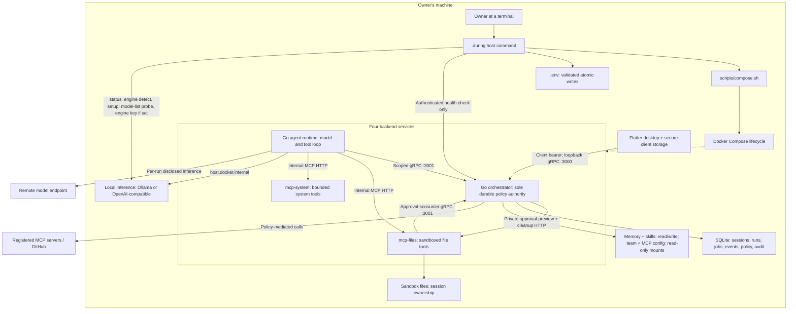
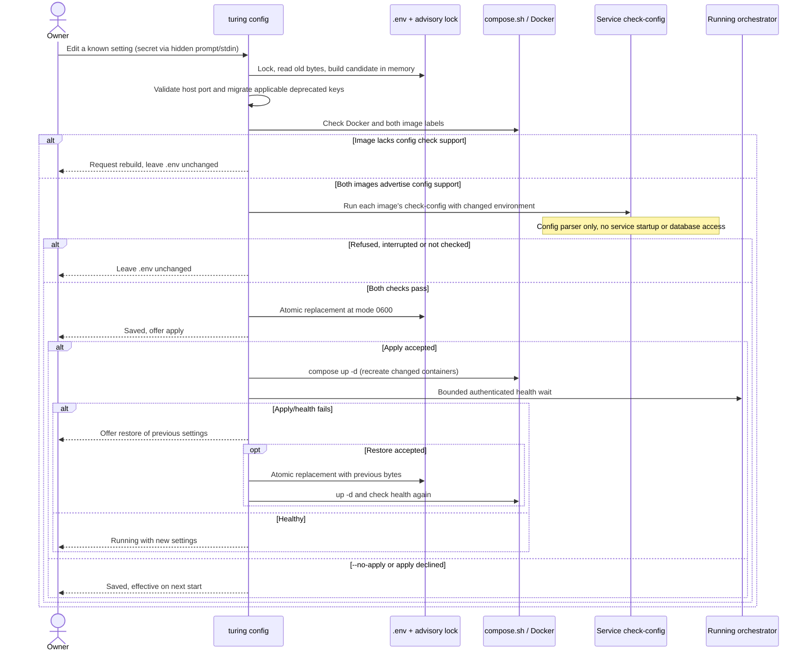
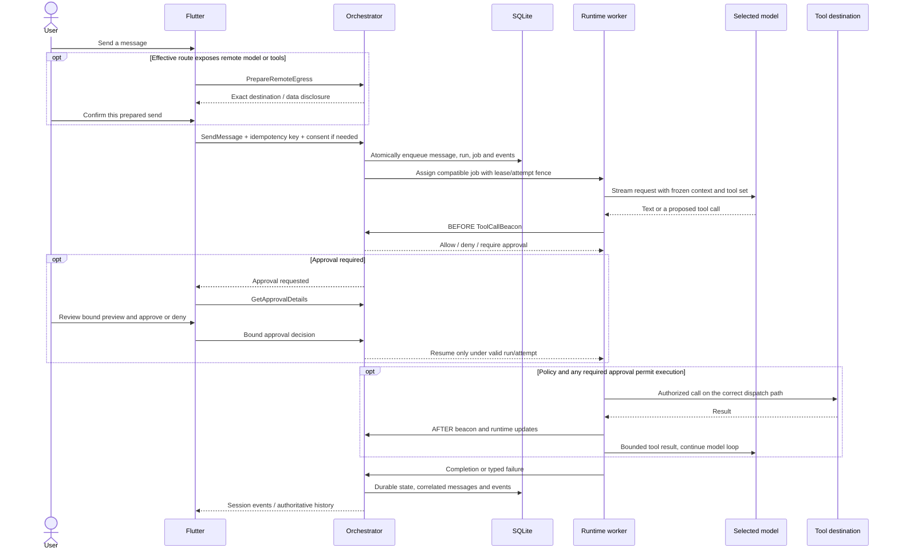
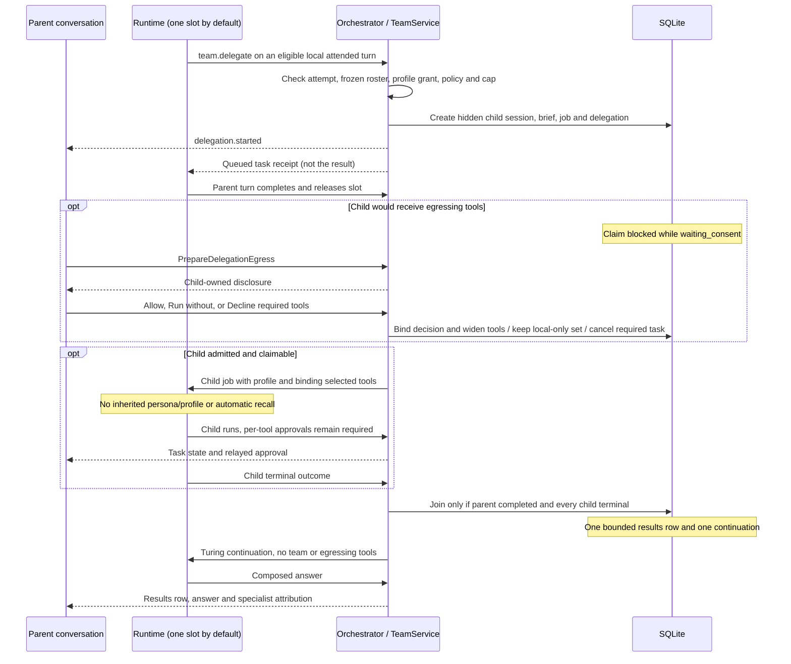
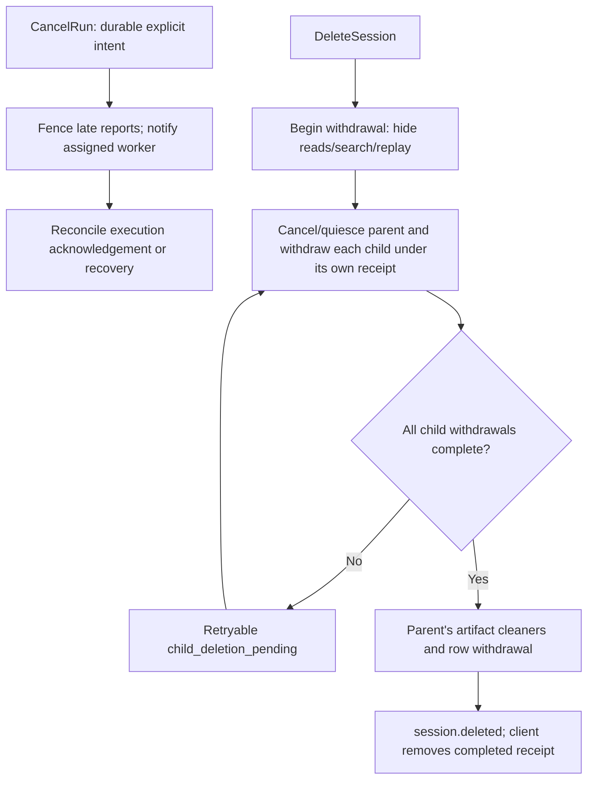

# TuringAgent: current architecture and execution flows

**Implementation snapshot:** `main` at `57461e49`, inspected 2026-10-31 UTC,
plus OPS-001 PR 3. This is the shipped architecture, not a second roadmap. The
[canonical roadmap](../NORTH_STAR.md) owns feature status and future gates.

Open [the animated runtime diagram](turing-flow.html) locally in a browser.
GitHub displays HTML as source; download the file or open it from your
checkout. It needs no server, CDN, credentials, or network access. The
Mermaid diagrams below remain readable directly on GitHub.

## What changed in the latest merges

| Delivered | Still outside this delivery |
| --- | --- |
| #171: orchestrator/runtime `check-config`, unknown-argument refusal, image support label | No database-backed startup validation inside the offline check |
| #173: host `turing` status, lifecycle, logs, connect/key rotation, validated configuration | Guided setup and engine commands arrive in the next row |
| OPS-001 PR 3: `turing setup`, `turing engine detect \| use \| check` and the runtime's `check-engine` | `check-engine` proves one engine's behavior, not model quality; no engine install or LAN engine |
| #173: Flutter Linux debug build in CI | No proof of a running desktop/keyring from a compile alone |
| #172: team/client/engine documentation reconciliation | No modern MCP protocol implementation |

The specialist team and child-owned egress consent are shipped but
experimental and off by default. Local engine selection and hardware-guided
engine choice are implemented ([local inference engines](local-engines.md)).
Current MCP remains the bounded 2025-11-25 surface; MCPP-001 through MCPP-009
are plans.

## 1. Runtime and administration are separate authorities



Default ports are shown; the public port is configurable. Only the public
orchestrator port is published to the host, on `127.0.0.1`. Internal MCP
ports are not public. External model inference leaves from the runtime;
registered MCP and GitHub requests leave through the orchestrator.
Registered MCP servers may instead be local containers on the dedicated
internal registry network.
The orchestrator also reads bounded file previews through
`/internal/approval-preview` using a signed short-lived preview capability.
Session cleanup uses its separate cleanup bearer and endpoint; neither is
general-purpose access to the bundled file-tool API.

The host command runs as the owner and can invoke Docker. Neither the runtime
nor the orchestrator can invoke it. It is not a fifth daemon, a model tool, or
a database client. `status` also probes the local engine's model list directly
from the host, without an HTTP proxy; an OpenAI-compatible engine receives
its configured engine key if one is set. `engine detect` and `setup` ask the
same way. These host-side probes are not the proof: `turing engine check` runs
the runtime's `check-engine` in a one-off runtime container, so the engine is
proved with the settings, network and provider code the runtime itself uses
(reachable, model present, streaming, tool calling). It is the only check that
uses the network, only to reach the configured engine, and it sends a fixed
prompt and no user data. `turing setup` runs `init.sh`, builds, saves choices
through the same validate-then-write flow as `config`, starts Turing, runs that
check and shows the connection.
The app runs on the backend host until SEC-001 supplies
paired device identity and encrypted transport; a headless server alone is
not a supported remote desktop setup.

**Evidence:** [Compose topology](../../turing-backend/infra/docker-compose.yml),
[public/internal service registration](../../turing-backend/orchestrator-go/internal/app/app.go),
[host command boundary](../../turing-backend/cmd/turing/imports_test.go),
[local engine factory](../../turing-backend/agent-runtime-go/internal/llm/local.go).

## 2. A settings change: validate before writing, apply separately



The image label is a safety gate: an older image could ignore `check-config`
and accidentally start another service against live state. The command strips
registry keys inherited from the shell before Compose calls, then passes
explicit candidate overrides for validation. It does not expose secrets in
arguments, `config show`, or errors. `connect` deliberately displays the
client key; `connect --rotate-key` is a distinct flow, not ordinary config.

Offline checks cannot see pending consent rows in SQLite. A database-dependent
refusal can therefore happen when applying. Restore is offered after a failed
apply/health wait, not a promise that every failure can be rolled back.
This is configuration recovery, not an application-data backup.

**Evidence:** [config save/validate/apply](../../turing-backend/cmd/turing/internal/cli/config_save.go),
[atomic writer and lock](../../turing-backend/cmd/turing/internal/envfile/write.go),
[Compose environment and image checks](../../turing-backend/cmd/turing/internal/host/host.go),
[offline service checks](../../turing-backend/internal/servicecmd/servicecmd.go).

## 3. Chat, tool policy and approval



The `Tool` lifeline summarizes different physical paths:

- Bundled files/system: runtime calls internal HTTP directly. Mutating file
  calls carry approval/provenance metadata; mcp-files verifies and consumes
  the approval through the orchestrator before writing. During review, the
  orchestrator separately obtains/revalidates a bounded preview from
  mcp-files with a short-lived preview capability.
- Registered MCP and GitHub: runtime calls an internal orchestrator facet;
  that service rechecks selection, policy, consent and active dispatch state,
  consumes any required approval, then contacts the destination.
- Memory, skills and team pseudo-tools follow their own existing dispatch
  paths; they do not grant an arbitrary third-party server internal authority.

Denied/expired/stale decisions never authorize execution. A lost response
after a possible mutation remains an uncertain outcome, not permission to
repeat it. Local OpenAI-compatible inference is local by endpoint, not
remote just because its protocol is OpenAI-shaped; remote tools still need
disclosure. Consent is not a replacement for per-tool mutation approval.

**Evidence:** [SendMessage](../../turing-backend/orchestrator-go/internal/service/chat/service.go),
[egress preparation](../../turing-backend/orchestrator-go/internal/service/chat/egress.go),
[tool runner](../../turing-backend/agent-runtime-go/internal/tools/runner.go),
[registered tool dispatch](../../turing-backend/orchestrator-go/internal/service/mcpregistry/call.go),
[approval previews](approval-previews.md).

## 4. Specialists: asynchronous work, separate consent, one join



The diagram shows the usual single-slot order, not a claim that UI consent
must wait for parent completion. Parent and child terminal transitions both
check the join conditions. Children that finish, fail or are declined are
accounted for; a failed/cancelled parent stops unfinished children and does
not produce a normal continuation. Specialists are profiles executed by the
same runtime, not three extra processes or parallel workers by default.

The team flag defaults false. Automations and remote-model parent turns do
not delegate. Child egress consent never carries to a sibling or continuation.
Reopening uses durable delegation records plus events, not local UI history.

**Evidence:** [creation gates](../../turing-backend/orchestrator-go/internal/service/team/call.go),
[child consent](../../turing-backend/orchestrator-go/internal/service/team/egress.go),
[transactional join](../../turing-backend/orchestrator-go/internal/repository/delegation_join.go),
[lifecycle](../../turing-backend/orchestrator-go/internal/repository/delegation_lifecycle.go),
[Flutter cards](../../turing-client/turing_app/lib/features/chat/delegation_card.dart).

## 5. Stop is not deletion, and neither means rollback



Already-committed external effects are not undone. A failed cleanup stays
visible/retryable rather than being labeled deleted. Withdrawal covers
Turing-owned state and artifacts, not remote vendors, external inference
engine caches, backups or forensic erasure.

**Evidence:** [explicit cancellation](../../turing-backend/orchestrator-go/internal/service/chat/explicit_cancel.go),
[withdrawal coordinator](../../turing-backend/orchestrator-go/internal/service/sessions/service.go),
[deletion receipts](../../turing-backend/orchestrator-go/internal/repository/session_delete.go),
[documented lifecycle](session-lifecycle.md).

## Maintaining the visual artifact

The animated diagram uses the user-installed
[Archflow skill](https://github.com/rafaelolsr/archflow/tree/40bff6a8ea632c545dbd308b2939ffdc1ff96d16/plugins/archflow/skills/archflow),
pinned at `40bff6a8ea632c545dbd308b2939ffdc1ff96d16`. Only its diagram skill is
needed; the deployment companion is not installed. These are contributor
Copilot skills, not Turing runtime `SKILL.md` capabilities or grants.

Install the same revision for Copilot with GitHub CLI's skills support:

```bash
gh skill install rafaelolsr/archflow plugins/archflow/skills/archflow \
  --agent github-copilot --scope user \
  --pin 40bff6a8ea632c545dbd308b2939ffdc1ff96d16
```

Restart a Copilot conversation if its skill list was already loaded before
installation. The files are in `~/.copilot/skills/archflow`; installation
does not upload this repository or install a Claude-specific command.

Edit [the evidence/geometry manifest](turing-flow.hero.json) and
[the presentation template](turing-flow.template.html), then from the repo root:

```bash
node "$HOME/.copilot/skills/archflow/scripts/hero-diagram.mjs" validate \
  docs/architecture/turing-flow.hero.json --repo-root . \
  --artifact docs/architecture/turing-flow.html
node "$HOME/.copilot/skills/archflow/scripts/hero-diagram.mjs" render \
  docs/architecture/turing-flow.hero.json docs/architecture/turing-flow.html \
  --template docs/architecture/turing-flow.template.html --repo-root .
```

The manifest checks source paths/ranges, diagram geometry and phase coverage.
The offline `tools/docs` tests additionally keep the HTML/template, embedded
chapters, entity/flow IDs, source ranges and this guide's relative file links
consistent without installing Node. These checks do not prove an arrow is
semantically true or regenerate changed SVG geometry. Recheck the cited
implementation, render again after manifest/template changes, then inspect
desktop/narrow layouts, all phases, keyboard controls, reduced motion, theme
changes and print. The renderer is not vendored and is not required by
Turing's build or runtime.
